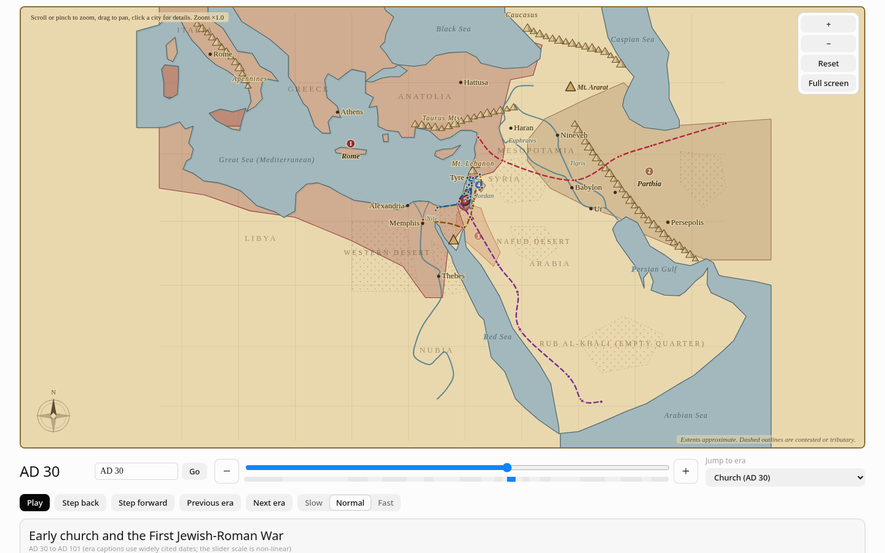

# Biblical Kingdoms Map

An interactive map of the Biblical kingdoms, empires and modern states, from **2000 BC to 2026**. Drag a timeline and watch the borders change. Click a kingdom, a city, a trade route or a journey to read about it, with scripture links, archaeology notes and sources.



**Live demo:** [cdrjohnson.github.io/biblical-kingdoms-map](https://cdrjohnson.github.io/biblical-kingdoms-map/)

**User guide:** [docs/USER_GUIDE.md](docs/USER_GUIDE.md) · [PDF](docs/User-Guide.pdf) · **Outline checks:** [docs/ATLAS_CHECK.md](docs/ATLAS_CHECK.md)

## Features

- **Timeline from 2000 BC to 2026.** The slider uses a non-linear scale that gives the Biblical period the most room. It has 23 eras with captions, an era jump menu, play/pause with three speeds, step buttons, a ± one-year button at each end of the slider, and a year box that understands `586 BC`, `-586`, `AD 70`, `70 CE`, `1948` and similar.
- **28 kingdoms, empires and states**, from the Patriarchs to the Ottoman, Mandate and modern eras, with the borders redrawn for each period. Modern borders use the 1949 armistice lines, UN partition plan, and so on, with disputed, proposed or provisional areas **dashed**.
- **Smooth zoom and pan** (wheel, drag, pinch, buttons), four view presets, and detail that grows as you zoom in.
- **Geography layer**: mountains, hills, deserts, rivers, seas, in a parchment atlas style.
- **Cities and towns (119):** click a dot or label for names (ancient and modern), a short description, a dated timeline with the events nearest the slider highlighted, who held the place in the selected year, Biblical significance with BibleGateway links, and sources. 34 major cities have full entries, and 33 of those have an **archaeology** section (excavations, dated finds, what they show, and whether the identification is certain or debated). A search box finds any city and zooms to it.
- **Trade routes and journeys**: four trade routes, and eight journeys (Abraham, the Exodus, the return from exile, Jesus, and Paul's four journeys), each with key stops, scripture and notes on what is debated.
- **A grouped Layers control** with Show all / Hide all, colour swatches, collapsible groups, and one setting for "only when its period is active".
- **Map index** listing what is on the map for the selected year.
- **Full screen** using the browser's Fullscreen API, with the slider, layers, index and details still available.
- **Remembers the last year** you chose (in `localStorage`) and opens at **AD 30** by default.
- **Sources throughout:** about 290 references (Bible atlases, encyclopedias, museum essays, Wikipedia, and UN documents and treaty texts for the modern period), grouped at the bottom of the page.
- Works on desktop and phones, in light and dark mode (follows your system setting), with no server and no tracking.

## Install and run

You need **Node.js 18 or newer**.

```bash
npm install
npm run dev        # development server with hot reload
npm run build      # type-check and build static files into dist/
npm run preview    # serve the built site at http://127.0.0.1:4173/biblical-kingdoms-map/
```

Other scripts:

```bash
npm run typecheck  # TypeScript only
npm run test:e2e   # end-to-end checks in headless Chromium (needs `npm run preview` running)
npm run docs:pdf   # rebuild docs/User-Guide.pdf from docs/USER_GUIDE.md
```

The first time you run the browser tests: `npx playwright install chromium`.

## Deployment

The site is plain static files, so it can be hosted anywhere. The Vite `base` is set to `/biblical-kingdoms-map/` for GitHub Pages (change it in `vite.config.ts` if you rename the repository).

1. Create a public repository named `biblical-kingdoms-map` and push this code to the `main` branch.
2. In the repository, open **Settings → Pages** and set **Source** to **GitHub Actions**.
3. The workflow in `.github/workflows/deploy.yml` builds the site and deploys it on every push to `main`. The address is `https://<your-username>.github.io/biblical-kingdoms-map/`.

## How the data and sources work

All the data lives in `src/App.tsx`, as plain TypeScript, so there is nothing to fetch and nothing to break:

- **Kingdoms** are lists of keyframes. Each keyframe says "from year A up to year B, this is the outline", with a note and its sources. Outlines are simple hand-drawn polygons in longitude and latitude.
- **Cities** have a short entry (one line, dates, a Wikipedia link) or a full entry (names, description, dated events, scripture, Biblical significance, sources, and for major cities an archaeology section).
- **Routes and journeys** list their legs, stops, scripture and the points scholars disagree on.
- **Sources** are in one table (`S`) and are linked from every panel and from the References section. Wikipedia links were checked to exist. Britannica pages block automated checks, so those were confirmed through search results. Wikipedia is a secondary source; follow its citations for scholarship.
- `src/kit.tsx` is a small set of UI components (buttons, toggles, sections, light and dark themes) the page is built from.

## Borders are approximate

Outlines are simplified, hand-drawn polygons, **not surveyed borders** and not traced from any atlas. Ancient states rarely had fixed frontiers, and scholars disagree about many extents (for example Solomon's dominion, the settlement of Israel, and the Hasmonean and Nabataean limits). Dates before about 1000 BC are especially uncertain. For the modern period, solid outlines mean an agreed or long-settled status, and **dashed** outlines mean a proposal, provisional administration, or an area whose status is disputed. The wording tries to be neutral and cites UN and treaty documents. If you find an error, please open an issue with a source.

## Scripture and licensing notes

Scripture references link to [BibleGateway](https://www.biblegateway.com) (NRSVUE on their site). No Bible text is bundled. Any verse text quoted in this project would be from a public-domain translation: the **KJV** or the **WEB**. See [NOTICE](NOTICE).

## Contributing

Issues and pull requests are welcome, especially for:

- corrections to dates, outlines or descriptions (please cite a source),
- new cities, with the dates and a verified link,
- accessibility and mobile improvements.

Before sending a pull request, run `npm run build` and, with `npm run preview` running, `npm run test:e2e`. Keep the wording neutral on disputed topics and say plainly when a date or identification is uncertain.

## License

[MIT](LICENSE) © 2026 cdrjohnson. Linked sources keep their own licences; see [NOTICE](NOTICE).
