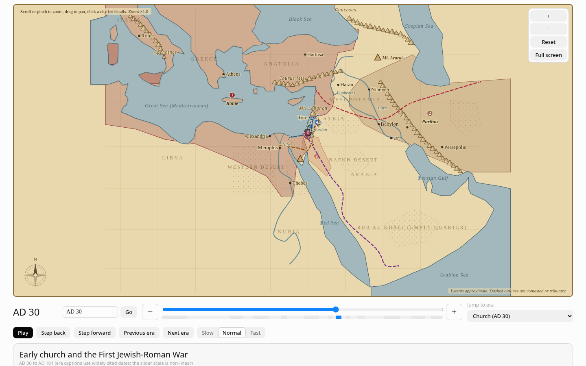
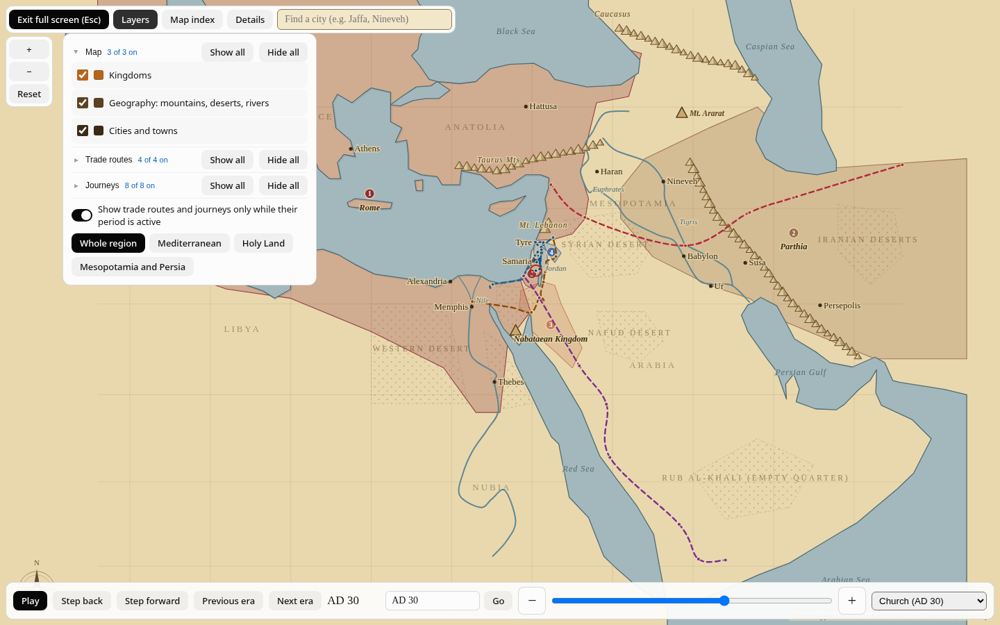
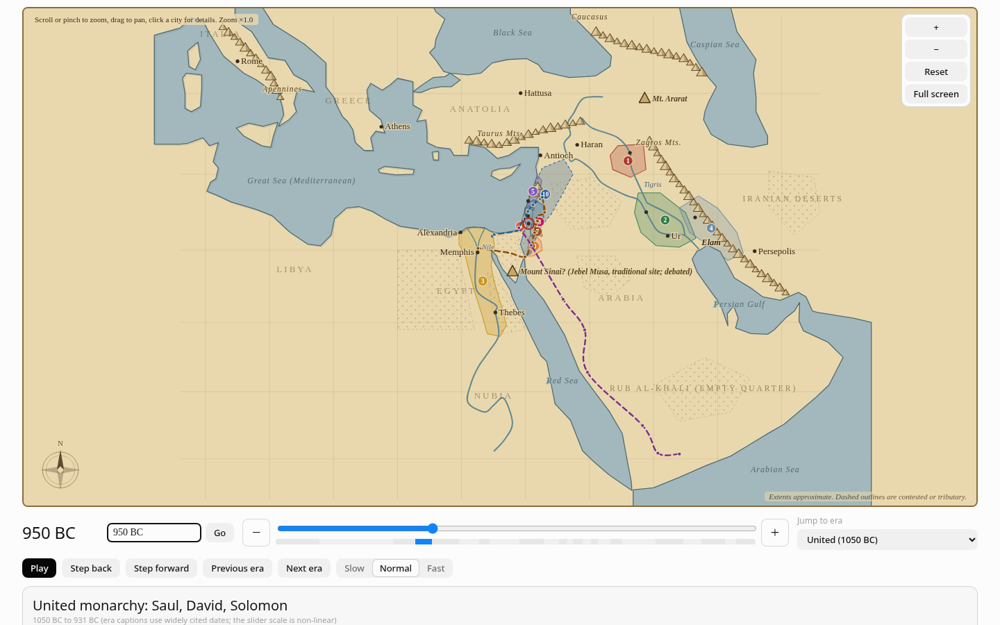
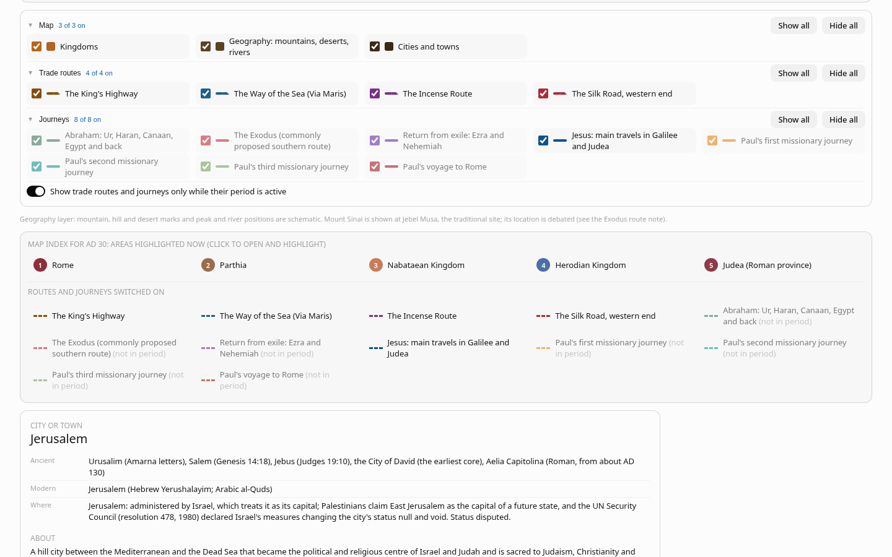
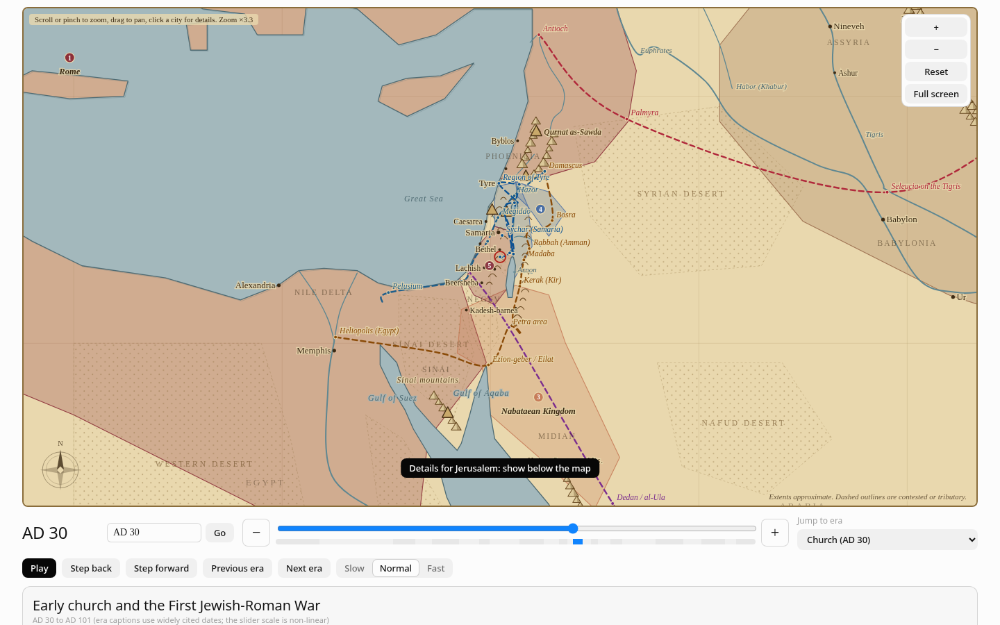
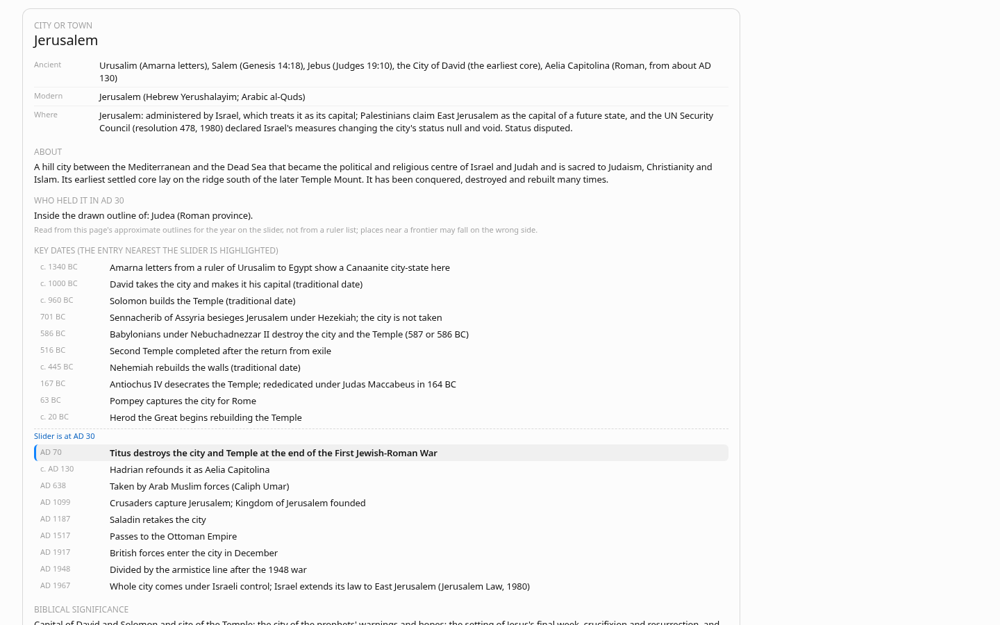
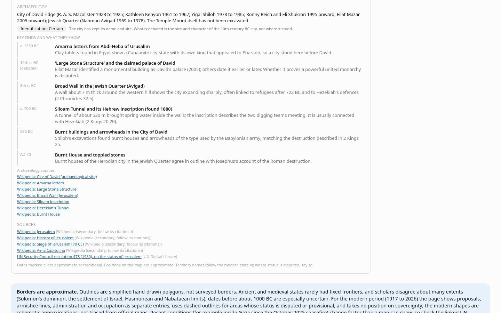
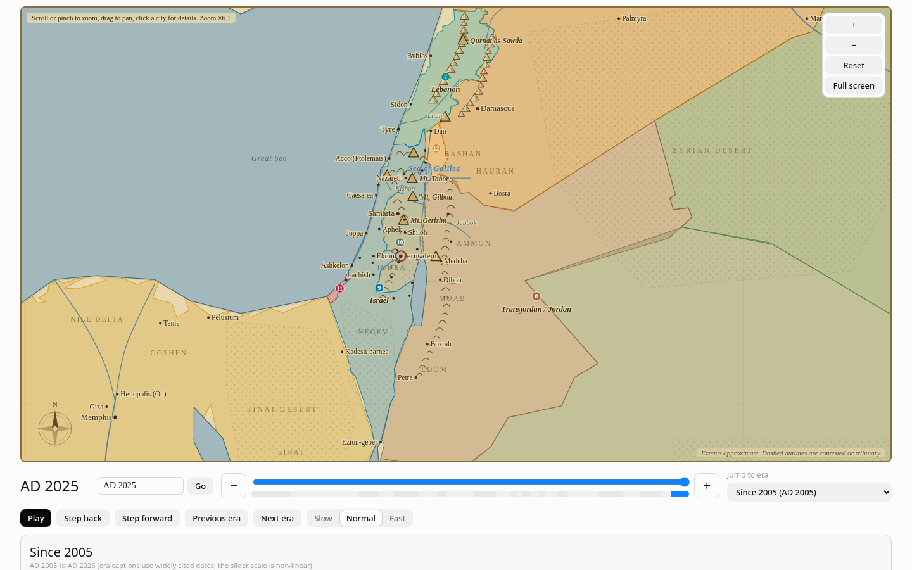
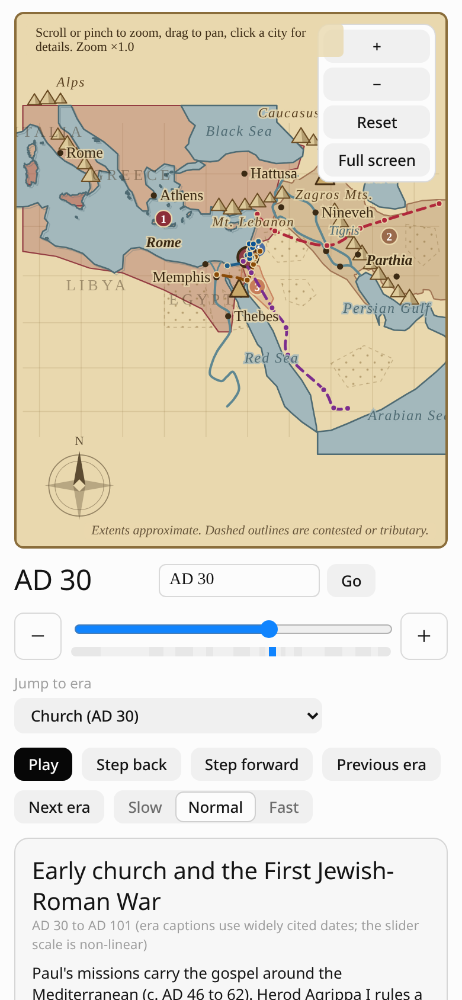

# Biblical Kingdoms Map: User Guide

This guide explains every part of the map in plain language. You do not need any technical knowledge. If you can use a web page, you can use this.

**What it is.** A map you can move through time. Pick a year from 2000 BC to 2026, and the map shows which kingdoms, empires and states existed then. Click anything to read about it: who ruled, what the Bible says, what archaeologists have found, and where the information came from.

---

## 1. Getting started

When you open the map it shows **AD 30**, the time of Jesus's ministry (the date is approximate and debated). The page remembers the last year you chose, so next time it opens where you left off (see [section 14](#14-the-remembered-year)).

From top to bottom the page has:

1. **View buttons and search**: Whole region, Mediterranean, Holy Land, Mesopotamia and Persia, a Full screen button, and a box to find a city.
2. **The map.**
3. **The timeline**, directly under the map: the year, a year box, the slider, and Play and step buttons.
4. **The era caption**: a short summary of the period.
5. **Layers**: switch kinds of information on and off.
6. **The map index**: a list of what is on the map right now.
7. **The details panel**: opens when you click something on the map.
8. **Notes and references** at the bottom.

On a phone the same things are stacked in one column.

---

## 2. The timeline

### The slider

Drag the slider to change the year. The scale is **not even**: the Biblical period (2000 BC to AD 100) takes up about two thirds of the slider, so you can move through it slowly. AD 100 to 1500 is squeezed into a short stretch, then 1500 to 1900, and finally 1900 to 2026 gets a quarter of the slider so the modern borders are easy to reach.

Under the slider is a thin **coloured strip**. Each block is an era. Click a block to jump to that era (hover to see its name). The current era is highlighted.

You can also use the keyboard: click the slider, then press the arrow keys, **Home** (2000 BC) or **End** (2026).

### The year box

Next to the year there is a box where you can **type a year** and press **Enter** or the **Go** button. It understands:

| You type | It means |
|---|---|
| `586 BC` or `586 BCE` | 586 BC |
| `-586` | 586 BC |
| `AD 70`, `70 CE` or just `70` | AD 70 |
| `1948` | AD 1948 |

Rules to remember: a plain positive number means **AD**, there is **no year 0** (1 BC is followed by AD 1; typing 0 shows AD 1 with a short hint), and years outside the map's range are moved to the nearest end (2000 BC or 2026) with a short note. If the box cannot read what you typed, it says so under the box. The box always shows the current year as you move the slider.

### The − and + buttons

At each end of the slider are two square buttons:

- **−** goes **one year earlier**, **+** goes **one year later**.
- **Hold** the button to repeat. After about half a second it speeds up, and after about a second more it moves **10 years** at a time.
- **Shift + click** moves 10 years at once.
- They skip the missing year 0, so AD 1 minus one year is 1 BC. A short hint under the year box says so when you step across it.

### Step, Previous and Next era, and Play

- **Step back / Step forward** move by a sensible amount: 25 years in the early period, 100 years from AD 100 to 1900, and 5 years in the modern period.
- **Previous era / Next era** jump to the start of the neighbouring era.
- **Jump to era** (the drop-down) lists all 23 eras, from *Patriarchs* (2000 BC) to *Since 2005*.
- **Play** runs the timeline forward automatically, and **Pause** stops it. Choose **Slow, Normal or Fast**. When it reaches 2026 the button becomes **Replay**.

---

## 3. Moving around the map

- **Zoom:** scroll the mouse wheel, pinch with two fingers on a touch screen, or use the **+** and **−** buttons at the top right of the map. The note at the top left says "Scroll or pinch to zoom, drag to pan, click a city for details" and shows the zoom (for example "Zoom ×6.1").
- **Pan:** click and drag (or drag with one finger).
- **Reset** returns to the whole region.
- **View buttons** above the map jump to a ready-made view: **Whole region**, **Mediterranean**, **Holy Land** and **Mesopotamia and Persia**.
- The more you zoom in, the more is shown: more towns, labels, hills and rivers. Labels never overlap; if a name is missing, zoom in.
- A small note at the bottom right reads "Extents approximate. Dashed outlines are contested or tributary."

The map is as wide as your screen. On a wide screen it is a wide rectangle (never taller than 80% of the screen height, so the slider stays in reach). On a phone it is taller.

---

## 4. Full screen

Press **Full screen** (above the map, or at the top right of the map) to fill your whole screen with the map. In full screen you still have everything:

- A bar at the **bottom** with Play, Step, era buttons, the year box, the slider with its − and + buttons, and the era drop-down.
- At the **top**: **Exit full screen**, **Layers**, **Map index**, **Details**, and the city search.
- The **+ − Reset** zoom buttons on the left.

Press **Layers**, **Map index** or **Details** to open that panel over the map, and press it again to close it. Clicking a city or a kingdom opens the Details panel for you. Leave full screen with **Esc** or the **Exit** button.

---

## 5. Kingdoms and empires

Coloured areas on the map are the kingdoms, empires and states that existed in the selected year. Each has a **number** marker, and the same numbers appear in the **Map index**.

- **Click an area or its number** to open its panel (see section 10).
- **Dashed outlines** mean the area is contested, a tributary, a proposal or provisional (see section 12).
- The outlines are **approximate**. They are hand-drawn simplifications, not surveyed borders. Many were redrawn in October 2026 against open reference maps and Natural Earth coasts, and each panel names what it was checked against (see `docs/ATLAS_CHECK.md` in the repository).

---

## 6. Layers

The **Layers** control (under the era caption, and as a panel in full screen) switches information on and off. It has three groups. Click a group's title to open or close it. Each group shows how many of its items are on (for example "3 of 3 on") and has **Show all** and **Hide all**.

**Map**

- **Kingdoms**: the coloured areas and their names.
- **Geography: mountains, deserts, rivers**: the atlas-style hills, peaks, deserts, rivers and seas.
- **Cities and towns**: the dots and names (and the click targets).

**Trade routes** (each has a coloured dashed swatch matching its line on the map)

- The King's Highway
- The Way of the Sea (Via Maris)
- The Incense Route
- The Silk Road, western end

**Journeys** (each has a coloured swatch)

- Abraham: Ur, Haran, Canaan, Egypt and back
- The Exodus (commonly proposed southern route)
- Return from exile: Ezra and Nehemiah
- Jesus: main travels in Galilee and Judea
- Paul's first, second and third missionary journeys, and his voyage to Rome

There is **one** switch at the bottom: **"Show trade routes and journeys only while their period is active."** When it is on, a route appears only when the slider is within its dates (for example, Paul's journeys show only around AD 46 to 62). A route that is ticked but out of period looks faded in the list.

---

## 7. Trade routes and journeys

Click a route's line on the map (or its name in the Layers list or the Map index) to see its panel: the dates it covers, **key stops** with scripture references, a description, notes on **what is debated or simplified**, scripture links and sources. Stops are named on the map in the route's colour when you are zoomed in or have it selected.

Some routes are uncertain. For example, the Exodus route shown is only one proposal, and Mount Sinai is marked at Jebel Musa, the traditional site, with its location noted as debated.

---

## 8. Cities and towns

There are **119 cities and towns** on the map. Zoom in to see more of them.

- **Click a dot or a name** to open its panel. Dots have a generous click area, and in crowded places a click goes to the nearest dot.
- **Search:** type a name in the **Find a city** box (for example *Jaffa*, *Nineveh* or *Bethlehem*). It matches the ancient or the modern name. Press **Enter** or click a suggestion and the map centres and zooms on it, and opens its panel.

### What a city panel shows

1. **Name** with its **ancient** and **modern** names and the modern country or territory, named neutrally (for example Joppa / Jaffa). Disputed places say so, for example "West Bank (status disputed)".
2. **About**: two or three sentences.
3. **Who held it in [the year on the slider]**: read from the kingdom outlines. Treat it as a guide only: places near a frontier may fall on the wrong side.
4. **Key dates**: a short timeline of founding, conquests, destructions and rebuilding. The entry **nearest the slider's year is highlighted**, with a "Slider is at ..." marker at the right place in the list. Dates marked "c." are approximate or traditional.
5. **Biblical significance** and **scripture** links.
6. **Archaeology** (see below).
7. **Sources.**

34 major cities have full entries (Jerusalem, Samaria, Shechem, Hebron, Bethlehem, Nazareth, Capernaum, Jericho, Megiddo, Hazor, Dan, Beersheba, Gaza, Ashkelon, Ashdod, Joppa, Caesarea, Tyre, Sidon, Damascus, Antioch, Babylon, Nineveh, Ur, Haran, Susa, Persepolis, Memphis, Thebes, Alexandria, Ephesus, Corinth, Athens and Rome). The other 85 towns have a one-line description, dates and a source.

### Archaeology

33 of the major cities (all except Gaza) have an **Archaeology** section:

- **Excavations**: who dug there and when.
- **Identification**: a label showing whether the ancient city is **Certain**, **Debated**, or a mix (for example "Certain for the city; not verifiable for the tomb").
- **Key finds and what they show**: each with a date, what was found (for example the Siloam inscription, the Tel Dan Stele, the Pilate Stone, the Ishtar Gate), and what it tells us, including where scholars disagree.
- **Archaeology sources**: links to articles.

---

## 9. The map index

Under the layers is the **Map index for [year]**. It lists every area that is on the map now, with the same numbers as on the map, and below that the routes and journeys you have switched on (marked "not in period" if they are out of date). **Click any item** to open its panel and highlight it on the map. It is a quick way to find a small kingdom you cannot see.

---

## 10. The details panel

Click something on the map and its panel opens. On a wide screen the panel sits **below the map and timeline**, so you do not lose your place. A button appears over the map saying **"Details for ...: show below the map"**: press it to scroll straight to the panel (it fades after a few seconds). In full screen the panel opens over the right side of the map.

**A kingdom panel** shows: whether it is present in the selected year, its dates, the **extent** at that time, **key rulers** for the period, a description, any **disputed or debated** points, scripture links, and sources for both this extent and the kingdom in general.

**A route or journey panel** shows its dates, key stops, description, debated points, scripture and sources.

**A city panel**: see section 8.

---

## 11. The era caption and the notes at the bottom

- The **era caption** under the slider names the period, gives its dates, a summary, scripture links, and a "Sources for this caption" list. Era dates are widely cited ones; the slider scale is not even.
- **Borders are approximate** (a note box).
- **Dating notes: where dates are disputed**: a table of the main uncertain dates (Abraham, the Exodus, the Judges, the United Monarchy, the fall of Samaria and Jerusalem, Ezra, Jesus, Paul's journeys).
- **Modern borders: how this page labels them**: the conventions below.
- **References**: every source used, in groups: **Bible atlases, Encyclopedias, Museum and other essays, UN documents and treaty texts, and Wikipedia articles**. Click a group to open or close it. Links open in a new tab.

---

## 12. Modern borders and dashed lines

From the 1900s on, the map shows modern states. It tries to be **neutral and to rely on documents**:

- **Solid outline**: an area with an agreed or long-settled status, such as Israel inside the 1949 armistice lines, or states with treaty borders.
- **Dashed outline**: a **proposal** (such as the 1947 UN partition recommendation), **provisional administration**, or an area whose **status is disputed** (such as the West Bank including East Jerusalem, the Gaza Strip, and the Golan Heights).
- Places are named with their status where it is disputed, and the sources are UN General Assembly and Security Council resolutions, treaty texts (Oslo, the Jordan and Egypt treaties, the Armistice agreements), and UN agencies.

---

## 13. Light and dark mode, phones and tablets

- The page **follows your device's light or dark setting**. The map itself keeps its parchment look in both.
- On a **phone** the map is taller, the controls wrap, and you can use two fingers to zoom. Full screen works the same way.

---

## 14. The remembered year

Whenever you change the year (slider, buttons, year box, era jump or Play), the page saves it in your browser (this uses your browser's own storage, nothing is sent anywhere). Next time you open the page it starts at that year. If nothing is saved, or your browser blocks storage (for example in a private window or some embedded pages), it simply starts at **AD 30** and works normally.

To start again at AD 30, type `AD 30` in the year box.

---

## 15. FAQ

**Why isn't the birth of Jesus at 0 BC/AD?** There is no year 0: the calendar goes from 1 BC straight to AD 1. The AD count was devised by Dionysius Exiguus around AD 525. Matthew 2 places the birth under Herod the Great, who died c. 4 BC, so it is dated c. 6 to 4 BC. The same note is in the Herod era caption and under the dating table at the bottom of the page.

**Why does the slider move so slowly in the Biblical period?** On purpose: the scale gives the Biblical period the most room, and shrinks later centuries.

**How accurate are the borders?** They are rough, hand-drawn shapes, good for "who was roughly where", not for exact frontiers. Ancient kingdoms rarely had fixed borders, and scholars disagree about many of them. See the notes at the bottom of the page.

**A name or a town is missing.** Zoom in. Smaller towns appear only when there is room for their labels. Also check the **Cities and towns** layer is on.

**Why does a city say who held it, and it looks wrong?** That line is read from the approximate outlines for the year on the slider. Places near a frontier may fall on the wrong side. Use the city's key dates for the real history.

**What does "c." mean?** "Circa": about. Traditional or uncertain dates are marked this way.

**Why is a date "debated"?** Some dates and identifications (for example the Exodus, Ur, or the conquest of Jericho) are disputed by scholars. The panels say so rather than choose a side.

**Are these facts reliable?** Each panel links its sources. Wikipedia is a secondary source, so follow its citations for serious study. Some publisher sites block automated checks, so a few links may need opening in a browser.

**Why is Gaza missing an archaeology section?** It was left out because it could not be sourced well enough.

**Does it send my data anywhere?** No. It is a static page with no tracking. The only thing stored is your last year, in your own browser.

**The year box says "could not read that year".** Try `586 BC`, `-586`, `AD 70`, `70 CE` or `1948`. There is no year 0.

**Can I use it offline?** Once the page has loaded, it works without a connection, except for links to outside sources.

**I found a mistake.** Please report it on the project's *Issues* page, with a source if you can.
